# Sistema de Envio de E-mails em Massa (Paralelo & Distribuído)

Sistema de alta performance e tolerância a falhas para disparo de e-mails em massa em Python, implementando e comparando duas arquiteturas complementares:
1. **Arquitetura Paralela Local (Mesma Máquina — Foco em Velocidade & Baixa Latência)**
2. **Arquitetura Distribuída em Contêineres (Rede & Docker — Foco em Escala Horizontal & Resiliência)**

O projeto inclui suíte de testes automatizados para benchmarking, análise de contenção do GIL, testes de consistência com gabarito estrito e **Chaos Testing (simulação de falhas via `docker kill`)** com auditoria de **zero duplicação de e-mails**.

---

## Índice

- [1. Visão Geral da Arquitetura](#1-visão-geral-da-arquitetura)
- [2. Carga de Trabalho Padronizada](#2-carga-de-trabalho-padronizada)
- [3. Decisões de Engenharia](#3-decisões-de-engenharia)
  - [3.1. Threads vs. Processos e o Impacto do GIL](#31-threads-vs-processos-e-o-impacto-do-gil)
  - [3.2. Controle de Concorrência: Zero Lock Contention](#32-controle-de-concorrência-zero-lock-contention)
  - [3.3. Idempotência e Consistência Forte na Fonte da Verdade](#33-idempotência-e-consistência-forte-na-fonte-da-verdade)
  - [3.4. Consistência Forte vs. Consistência Eventual](#34-consistência-forte-vs-consistência-eventual)
  - [3.5. Resiliência no Broker (RabbitMQ) e Tolerância a Falhas](#35-resiliência-no-broker-rabbitmq-e-tolerância-a-falhas)
  - [3.6. Timeouts e Retries com Exponential Backoff](#36-timeouts-e-retries-com-exponential-backoff)
- [4. Estrutura do Repositório](#4-estrutura-do-repositório)
- [5. Guia Rápido de Instalação e Execução](#5-guia-rápido-de-instalação-e-execução)
- [6. Como Executar os 4 Testes Reais](#6-como-executar-os-4-testes-reais)
  - [Teste 1: Referência Sequencial (Baseline)](#teste-1-referência-sequencial-baseline)
  - [Teste 2: Escala Paralela (Threads vs. Processos)](#teste-2-escala-paralela-threads-vs-processos)
  - [Teste 3: Escala Distribuída (1, 2 e 3 Workers)](#teste-3-escala-distribuída-1-2-e-3-workers)
  - [Teste 4: Chaos Test (Queda Forçada com `docker kill`)](#teste-4-chaos-test-queda-forçada-com-docker-kill)
- [7. Suíte de Testes Automatizados (Pytest)](#7-suíte-de-testes-automatizados-pytest)
- [8. Relatório de Resultados e Gráficos](#8-relatório-de-resultados-e-gráficos)

---

## 1. Visão Geral da Arquitetura

O sistema é projetado para processar com correção e eficiência lotes de 10.000 a 50.000 destinatários.

```mermaid
flowchart TD
    subgraph P1["PARTE 1: ARQUITETURA PARALELA (LOCAL)"]
        CSV[destinatarios.csv] --> Loader[Carregamento CSV - Sequencial]
        Loader --> Chunks[Divisão Equilibrada em Chunks]
        Chunks --> Execs{Executor}
        Execs -->|1 Worker| Seq[sequencial.py]
        Execs -->|2, 4, 8 Workers| Thr[paralelo_threads.py]
        Execs -->|2, 4, 8 Workers| Proc[paralelo_processos.py]
        Seq & Thr & Proc --> WorkerP1[Worker: Validação + Renderização CPU + Disparo I/O]
        WorkerP1 --> CounterLocal[Counter Local por Worker - Zero Locks]
        CounterLocal --> Reduce[MapReduce Local / Consolidar + Assert de Correção]
    end

    subgraph P2["PARTE 2: ARQUITETURA DISTRIBUÍDA (DOCKER)"]
        Cliente[Cliente / Benchmark] -->|POST /campanhas| API[Nó 1: API FastAPI]
        Cliente -.->|GET /status| API
        API -->|1. Salva Meta + Template| RedisCache[(Redis: Cache)]
        API -->|2. Publica Lotes 200| RabbitMQ[(Nó 2: RabbitMQ - emails.lotes)]
        
        RabbitMQ -->|ACK Manual / Prefetch=1| W1[Worker Réplica 1]
        RabbitMQ -->|ACK Manual / Prefetch=1| W2[Worker Réplica 2]
        RabbitMQ -->|ACK Manual / Prefetch=1| W3[Worker Réplica 3]
        
        W1 & W2 & W3 <-->|SETNX PX / Lease Atômico Lua| RedisTruth[(Redis: Fonte da Verdade)]
        W1 & W2 & W3 -->|POST /enviar + Idempotency-Key| Mock[Nó 4: SMTP Mock HTTP]
        Mock --> Audit[(Auditoria de Entregas)]
    end
```



---

## 2. Carga de Trabalho Padronizada

Todas as arquiteturas e benchmarks executam rigorosamente a mesma rotina por destinatário (definida no módulo central `common/carga.py`):

1. **Validação Sintática e de Negócio:**
   - Validação da sintaxe RFC-compliant do endereço via Regex (`EMAIL_REGEX`).
   - Verificação da flag de descadastramento (`opt_out == False`).
   - Descarte antecipado sem processamento de CPU ou chamada de rede.
2. **Renderização e Assinatura Criptográfica (CPU-bound):**
   - Substituição de variáveis no template HTML dinâmico (`{{nome}}`, `{{segmento}}`, `{{oferta}}`).
   - Geração de token de rastreio SHA-256 único por `sha256(campanha_id:id:email)`.
   - Aplicação de rodadas sucessivas de hashing encadeado (key stretching). Como opera sobre payloads de 32 bytes, o runtime de Python **não libera o GIL**, tornando a etapa estritamente CPU-bound.
3. **Disparo de Rede (I/O-bound):**
   - Simulação de latência de rede (5ms a 15ms por envio).
   - Inclusão do cabeçalho HTTP `Idempotency-Key: sha256(campanha_id:email)`.
   - Simulação de falhas transitórias de rede (~2% de SMTP 451/503) para forçar retries com backoff.
   - Simulação de falhas permanentes determinísticas (~0,5% de SMTP 550) para verificar consistência estrita dos contadores entre todas as arquiteturas.

---

## 3. Decisões de Engenharia

### 3.1. Threads vs. Processos e o Impacto do GIL

O CPython possui o *Global Interpreter Lock* (GIL), que garante que apenas uma thread nativa execute bytecode Python por vez dentro de um processo.

- **Fase I/O-bound (Chamadas SMTP / `time.sleep`):**
  - Quando um socket de rede ou chamada de sleep aguarda resposta, o interpretador Python **libera o GIL**.
  - Portanto, para cargas predominantemente I/O-bound, `ThreadPoolExecutor` atinge excelente *speedup* com baixo consumo de memória (compartilhamento de heap) e sem overhead de serialização IPC.
- **Fase CPU-bound (Renderização HTML e SHA-256):**
  - Durante o processamento criptográfico e manipulação de strings, o GIL **permanece retido**.
  - Sob múltiplas threads disputando CPU pura, o tempo total não escala linearmente e pode sofrer degradação devido ao *thread switching overhead* (intervalo de troca de 5ms do Python).
  - O `ProcessPoolExecutor`, por outro lado, inicializa processos do SO isolados, cada um com seu próprio interpretador Python e seu próprio GIL. Ele utiliza 100% de múltiplos núcleos físicos da CPU, obtendo speedup real na etapa CPU-bound.

> **Demonstração Experimental:** O benchmark inclui o **Teste 2b (Perfil 100% CPU)**, no qual a latência de I/O é zerada, evidenciando o teto imposto pelo GIL nas Threads vs. a aceleração linear obtida por Processos.

### 3.2. Controle de Concorrência: Zero Lock Contention

- **O Problema do Lock Global:**
  Utilizar um `threading.Lock` ou `multiprocessing.Lock` compartilhado a cada e-mail enviado cria um ponto central de contenção. Milhares de threads/processos disputam o mesmo endereço de memória, causando *cache-line bouncing*, preempção de contexto e destruição da escalabilidade.
- **A Solução (MapReduce Local):**
  Cada worker recebe um lote contíguo equilibrado (*chunk*) e acumula suas métricas em um `collections.Counter` **estritamente local** e privado.
  Ao término do lote, o processo/thread retorna seu dicionário de métricas. O processo mestre faz uma redução linear somando os contadores:
  $$\text{Total} = \sum_{i=1}^{N} \text{Counter}_i$$
  Não há um único `Lock` em todo o ciclo de vida da Parte 1, eliminando 100% da contenção de concorrência.
- **Verificação de Correção:**
  O processo consolidador executa a asserção obrigatória:
  $$\text{enviados} + \text{invalidos} + \text{opt\_out} + \text{erros\_smtp} == \text{TOTAL\_REGISTROS}$$
  Garantindo que ganhos de velocidade não resultem em corrupção de dados ou perda de eventos.

### 3.3. Idempotência e Consistência Forte na Fonte da Verdade

Na arquitetura distribuída, múltiplos nós podem reprocessar a mesma mensagem após falhas de rede ou quedas abruptas de workers. Para garantir que **nenhum destinatário receba o mesmo e-mail duas vezes**:

1. **Chave Determinística:**
   $$\text{idempotency\_key} = \text{SHA256}(\text{campanha\_id} : \text{email})$$
2. **Máquina de Estados Atômica em Lua (Redis):**
   O Redis atua como a *fonte da verdade* com consistência forte (execução single-threaded de scripts Lua atômicos):
   ```
   [Inexistente] ──SET NX PX (lease)──> [PROC:<worker_id>:<token>]
         │                                       │
         │ (se opt_out / inválido)               │ (após sucesso no SMTP)
         ▼                                       ▼
   [TERMINAL: INVALIDO / OPT_OUT]          [TERMINAL: ENVIADO / ERRO_SMTP]
   ```
3. **Lease com TTL (Fencing Token):**
   - Antes de iniciar o disparo, o worker adquire um lease temporário (`SET NX PX 15000`).
   - Se o worker cair antes de concluir, o lease expira e outro worker pode reassumir.
   - Ao concluir, o worker usa um script Lua com *fencing*: ele só altera para `ENVIADO` se o lease atual ainda for o dele, evitando *zombie writes*.
   - Se o destinatário já estiver em um estado terminal (`ENVIADO`), a operação é ignorada e o contador `duplicados_evitados` é incrementado.

### 3.4. Consistência Forte vs. Consistência Eventual

- **Consistência Forte (Fonte da Verdade - Idempotência):**
  - Aplicada no ciclo de envio do worker via Redis (operações atômicas `SETNX` e scripts Lua).
  - Garante que a transição de estado de cada destinatário seja linear e que nunca ocorra disparo duplicado.
- **Consistência Eventual (Monitoramento e Status da API):**
  - O endpoint `GET /campanhas/{id}/status` realiza leituras assíncronas dos hashes do Redis sem aplicar travas no broker nem nos workers.
  - O painel reflete o progresso com latência insignificante (<2ms), suficiente para acompanhamento de campanhas sem degradar a vazão de processamento.

### 3.5. Resiliência no Broker (RabbitMQ) e Tolerância a Falhas

- **Mensagens Persistentes e Fila Durável:** A fila `emails.lotes` é declarada com `durable=True` e as mensagens publicadas usam `DeliveryMode.PERSISTENT`.
- **Publisher Confirms:** A API de Campanhas só responde HTTP 202 após o RabbitMQ confirmar que todos os lotes foram persistidos em disco.
- **ACK Manual Estrito:** O worker consome com `no_ack=False`. O `msg.ack()` só é emitido após **todos** os destinatários daquele lote atingirem um estado terminal.
- **Prefetch Count = 1:** Evita que um único worker engula todas as mensagens da fila (*fair dispatch*).
- **Recuperação Automática de Quedas:** Se um contêiner worker for morto (`SIGKILL`), sua conexão AMQP é fechada pelo kernel do SO; o RabbitMQ detecta a perda e **imediatamente re-enfileira** os lotes pendentes para as demais réplicas ativas.
- **Dead Letter Queue (DLQ):** Mensagens corrompidas ou irrecuperáveis são roteadas para `emails.lotes.dlq` sem interromper o pipeline principal.

### 3.6. Timeouts e Retries com Exponential Backoff

- Utilização da biblioteca `tenacity` com retries condicionados a exceções transitórias (`ErroTransitorio` / HTTP 451, 503, timeouts).
- Aplicação de **Exponential Backoff com Jitter**:
  $$t_{\text{espera}} = \min(t_{\text{max}}, t_{\text{base}} \times 2^{\text{tentativa}}) \pm \text{jitter}$$
- Erros definitivos (SMTP 550 / HTTP 422 - caixa inexistente) abortam o retry imediatamente, poupando recursos.

---

## 4. Estrutura do Repositório

```text
.
├── Makefile                           # Automação de setup, testes unitários, benchmarks e Docker
├── README.md                          # Este documento arquitetural detalhado
├── RELATORIO_RESULTADOS.md            # Relatório técnico gerado automaticamente pelo benchmark
├── requirements.txt                   # Dependências do host (benchmark, testes, matplotlib)
├── pyproject.toml                     # Configuração de caminhos e ferramentas (pytest)
│
├── common/                            # Código compartilhado entre as Partes 1 e 2
│   ├── __init__.py
│   ├── carga.py                       # Carga padronizada: Regex, HTML, SHA-256 e regras SMTP
│   ├── csv_io.py                      # Leitura otimizada do arquivo de destinatários
│   ├── fila.py                        # Topologia e convenções de filas RabbitMQ e chaves Redis
│   └── smtp_cliente.py                # Clientes SMTP síncronos (Simulado e HTTP) com retries
│
├── dataset/                           # Geração e armazenamento do dataset de entrada
│   ├── __init__.py
│   ├── gerador_carga.py               # Gerador determinístico de 10k-50k contatos com opt-out e erros
│   └── destinatarios.csv              # Dataset gerado para os benchmarks
│
├── parte1_paralelo/                   # PARTE 1: Implementação na mesma máquina
│   ├── __init__.py
│   ├── nucleo.py                      # Chunks equilibrados, worker local, MapReduce e cProfile
│   ├── sequencial.py                  # Linha de base sequencial (1 processo, 1 thread)
│   ├── paralelo_threads.py            # Execução concorrente com ThreadPoolExecutor (2, 4, 8 threads)
│   └── paralelo_processos.py          # Execução paralela com ProcessPoolExecutor (2, 4, 8 processos)
│
├── parte2_distribuido/                # PARTE 2: Implementação distribuída em contêineres
│   ├── docker-compose.yml             # Orquestrador com RabbitMQ, Redis, API, Workers e SMTP Mock
│   ├── api_service/                   # Nó 1: API FastAPI para criação e status de campanhas
│   │   ├── Dockerfile
│   │   ├── main.py
│   │   └── requirements.txt
│   ├── worker_service/                # Nó 3: Workers assíncronos escaláveis com persistência e ACK
│   │   ├── Dockerfile
│   │   ├── idempotencia.py            # Lógica de idempotência atômica via scripts Lua no Redis
│   │   ├── worker.py                  # Loop assíncrono com aio-pika, aiohttp e tenacity
│   │   └── requirements.txt
│   └── smtp_mock/                     # Nó 4: Servidor SMTP Mock com auditoria e controle de delay
│       ├── Dockerfile
│       ├── main.py
│       └── requirements.txt
│
├── tests/                             # Suíte de testes unitários com pytest
│   └── test_nucleo.py                 # Validações de regex, hash, chunks, reduce e idempotência
│
├── benchmark_runner.py                # Orquestrador dos 4 testes reais, gerador de gráficos e relatório
└── resultados/                        # Artefatos gerados pelo benchmark
    ├── resultados.json                # Métricas brutas registradas
    └── graficos/                      # Gráficos comparativos gerados pelo matplotlib
        ├── p1_tempos.png
        ├── p1_speedup.png
        ├── p1_gil.png
        ├── p2_escala.png
        └── p2_chaos.png
```

---

## 5. Guia Rápido de Instalação e Execução

### Pré-requisitos
- **Python 3.10+** (recomendado Python 3.12)
- **Docker** e **Docker Compose v2** instalados e em execução.

### Instalação em 1 Comando
```bash
make setup
```
Ou manualmente:
```bash
python3 -m venv .venv
source .venv/bin/activate
pip install -r requirements.txt
```

---

## 6. Como Executar os 4 Testes Reais

### Teste 1: Referência Sequencial (Baseline)
Executa o processamento sequencial de referência (1 único processo e thread):
```bash
make teste1
# ou diretamente:
.venv/bin/python benchmark_runner.py --testes 1 --registros 10000
```
**O que é medido:**
- Tempo total de processamento da linha de base.
- Perfilamento de tempo gasto na leitura do CSV, CPU pura por e-mail e I/O de rede.
- Verificação de 100% de conformidade com o gabarito.

---

### Teste 2: Escala Paralela (Threads vs. Processos)
Executa a carga local variando entre **2, 4 e 8 Threads** (`ThreadPoolExecutor`) e **2, 4 e 8 Processos** (`ProcessPoolExecutor`), além do teste de isolamento de CPU (Teste 2b):
```bash
make teste2
# ou diretamente:
.venv/bin/python benchmark_runner.py --testes 2 --registros 10000
```
**O que é medido:**
- Cálculo exato de **Speedup** ($S = T_1 / T_N$) e **Eficiência** ($E = S / N$).
- Taxa de transferência em e-mails/segundo.
- Análise de contenção do GIL: comparação do atraso de retomada pós-I/O em Threads vs. Processos.

---

### Teste 3: Escala Distribuída (1, 2 e 3 Workers)
Sobe o ambiente Docker e executa o disparo variando dinamicamente a quantidade de contêineres worker (`--scale worker=1`, `2` e `3`), medindo o tempo total até o esvaziamento completo da fila:
```bash
make teste3
# ou diretamente:
.venv/bin/python benchmark_runner.py --testes 3 --registros 10000
```
**O que é medido:**
- Tempo de resposta imediato da API (`POST /campanhas`) com resposta assíncrona (<500ms).
- Tempo de esvaziamento da fila RabbitMQ e vazão global agregada.
- Auditoria no Nó 4 (SMTP Mock): comprovação de 0 e-mails duplicados e 100% dos destinatários válidos entregues.

---

### Teste 4: Chaos Test (Queda Forçada com `docker kill`)
Inicia uma campanha com 3 contêineres worker ativos. Ao atingir ~30% do processamento, o script executa um `docker kill` em uma das réplicas de worker, simulando uma falha catastrófica de hardware:
```bash
make teste4
# ou diretamente:
.venv/bin/python benchmark_runner.py --testes 4 --registros 10000
```
**O que é auditado e comprovado:**
- **Zero Downtime na API:** A API permanece saudável e respondendo às consultas de status durante todo o teste.
- **Reentrega Segura:** Os lotes que estavam sob processamento do worker derrubado são automaticamente re-enfileirados pelo RabbitMQ.
- **Idempotência Estrita:** Os workers remanescentes reassumem os lotes órfãos, pulam e-mails já registrados no Redis (`SETNX`) e evitam reenvio.
- **Auditoria de 0 Duplicatas:** O endpoint `/auditoria/{campanha_id}` do SMTP Mock atesta:
  $$\text{entregas\_duplicadas} == 0$$
  $$\text{destinatarios\_unicos} == \text{total\_validos}$$

---

### Executar a Bateria Completa de Testes
Para rodar os 4 testes em sequência, consolidar métricas, gerar gráficos e compilar o `RELATORIO_RESULTADOS.md`:
```bash
make benchmark
```

---

## 7. Suíte de Testes Automatizados (Pytest)

Para rodar os testes unitários de validação, renderização, divisão de chunks, consolidação sem lock e idempotência:
```bash
make test
# ou:
.venv/bin/pytest -v tests/
```

---

## 8. Relatório de Resultados e Gráficos

Ao executar o `benchmark_runner.py` ou `make benchmark`, os resultados consolidados são gravados em:
- Arquivo de documentação: `RELATORIO_RESULTADOS.md`
- Dados brutos JSON: `resultados/resultados.json`
- Gráficos PNG gerados em `resultados/graficos/`:
  - `p1_tempos.png` — Comparação de tempos na Parte 1.
  - `p1_speedup.png` — Curva de Speedup: Threads vs. Processos vs. Ideal.
  - `p1_gil.png` — Decomposição de tempo: CPU efetiva vs. espera do GIL vs. atraso pós-I/O.
  - `p2_escala.png` — Escalabilidade horizontal distribuída (1, 2 e 3 workers).
  - `p2_chaos.png` — Linha do tempo do Chaos Test com o instante do `docker kill`.
