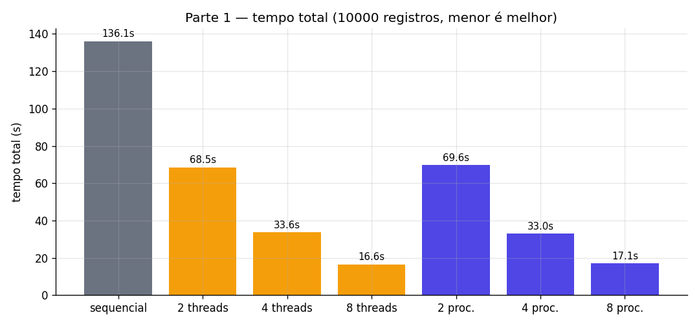
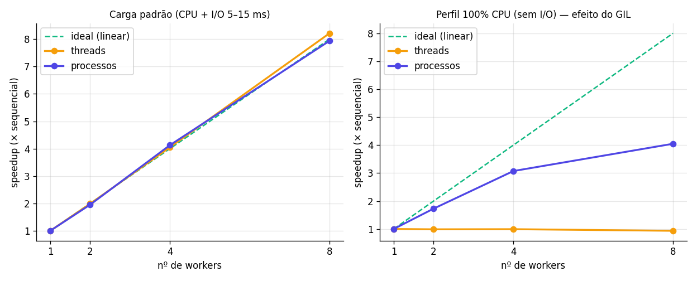
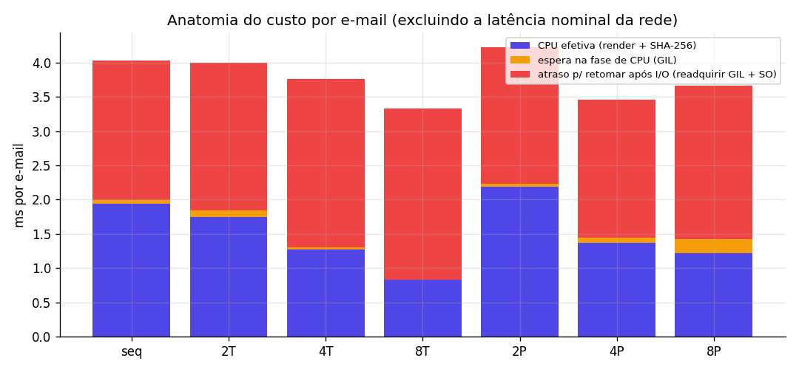
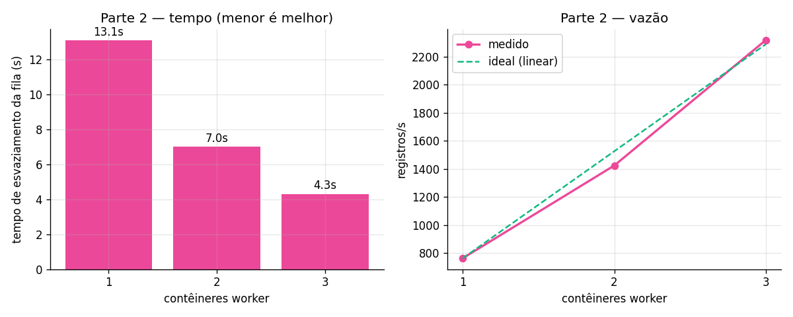
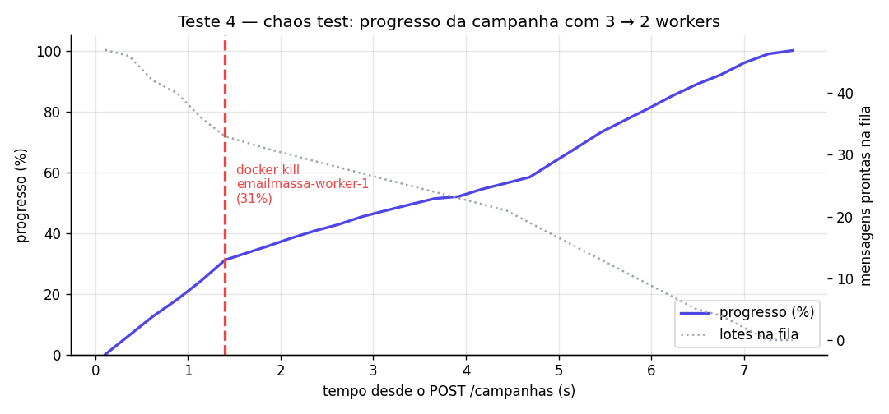

# Relatório de Resultados — Envio de E-mails em Massa

> Gerado automaticamente por `benchmark_runner.py` em 2026-10-25T23:37:00. Os números abaixo são **medidos** nesta máquina; reexecute para reproduzir.

## Ambiente e carga de trabalho

| Item | Valor |
|---|---|
| Plataforma | macOS-26.5.1-arm64-arm-64bit |
| CPUs lógicas (host) | 8 |
| Python | 3.12.6 |
| Docker | 27.3.1 | 8 vCPUs | 4109737984 B |
| Registros | 10000 |
| Seed do dataset | 42 |
| Gabarito | enviados=9435, invalidos=328, opt_out=177, erros_smtp=60 |

Cada e-mail: validação Regex + opt-out → renderização HTML + SHA-256 encadeado (CPU, `RODADAS_HASH=2000`) → disparo no SMTP Mock (5–15 ms, 2% de falhas transitórias com retry, ~0,5% de rejeições 550 determinísticas).

## Teste 1 — Referência sequencial

| Tempo total | CSV | Processamento | Consolidação | Registros/s | CPU/e-mail | Confere gabarito |
|---|---|---|---|---|---|---|
| 136.11s | 19.7ms | 136.09s | 2.18ms | 73.5 | 1.94ms | ✅ |

## Teste 2 — Escala paralela (mesma máquina)

| Modo | Workers | Chunks | Tempo | Speedup | Eficiência | Registros/s | CPU/e-mail (ms) | Espera GIL na CPU (ms) | Atraso pós-I/O (ms) | Confere |
|---|---|---|---|---|---|---|---|---|---|---|
| threads | 2 | 8 | 68.49s | 1.99× | 99% | 146.0 | 1.75 | 0.09 | 2.16 | ✅ |
| threads | 4 | 16 | 33.60s | 4.05× | 101% | 297.6 | 1.27 | 0.04 | 2.45 | ✅ |
| threads | 8 | 32 | 16.57s | 8.21× | 103% | 603.5 | 0.83 | 0.01 | 2.50 | ✅ |
| processos | 2 | 8 | 69.65s | 1.95× | 98% | 143.6 | 2.18 | 0.04 | 2.00 | ✅ |
| processos | 4 | 16 | 32.97s | 4.13× | 103% | 303.3 | 1.38 | 0.08 | 2.01 | ✅ |
| processos | 8 | 32 | 17.15s | 7.94× | 99% | 583.2 | 1.22 | 0.21 | 2.24 | ✅ |

- Melhor configuração: **8 threads** — 16.57s (**8.21×** o sequencial).
- Com 8 workers: threads = 8.21×, processos = 7.94×. Nesta carga ~90% do tempo de cada e-mail é espera de rede (que libera o GIL), por isso threads também escalam bem.
- O atraso para retomar após o I/O sobe de 2.04 ms (sequencial) para 2.50 ms com 8 threads: é o tempo que a thread espera para **readquirir o GIL** ao acordar. Com processos fica em 2.24 ms (cada processo tem o seu GIL).
- Todas as execuções passaram no `assert enviados + invalidos + opt_out + erros_smtp == TOTAL` e produziram **exatamente** os mesmos contadores do gabarito.

### Teste 2b — Perfil 100% CPU-bound (latência de rede = 0)

Mesma carga, porém sem a espera de rede: isola a etapa de renderização + SHA-256, que segura o GIL.

| Modo | Workers | Tempo | Speedup | Confere |
|---|---|---|---|---|
| sequencial | 1 | 5.42s | 1.00× | ✅ |
| threads | 2 | 5.48s | 0.99× | ✅ |
| threads | 4 | 5.46s | 0.99× | ✅ |
| threads | 8 | 5.79s | 0.93× | ✅ |
| processos | 2 | 3.13s | 1.73× | ✅ |
| processos | 4 | 1.76s | 3.07× | ✅ |
| processos | 8 | 1.34s | 4.05× | ✅ |

- **Efeito do GIL:** com 8 threads o speedup foi 0.93× (as threads se revezam no único GIL), enquanto 8 processos chegaram a 4.05× (um GIL por processo, limitado pelos núcleos físicos e pelo custo de spawn/pickle).







## Teste 3 — Escala distribuída (contêineres)

Cada worker é limitado a **1 vCPU** (`deploy.resources.limits.cpus`), simulando um nó independente. Tempo de esvaziamento = do `POST /campanhas` até o último destinatário ser finalizado (relógio do servidor).

| Workers | Esvaziamento | Registros/s | Speedup vs 1 worker | vs sequencial local | POST /campanhas | Duplicatas | Auditoria |
|---|---|---|---|---|---|---|---|
| 1 | 13.10s | 763.3 | 1.00× | 10.39× | 89ms | 0 | ✅ |
| 2 | 7.02s | 1424.7 | 1.87× | 19.39× | 156ms | 0 | ✅ |
| 3 | 4.31s | 2319.6 | 3.04× | 31.57× | 82ms | 0 | ✅ |



## Teste 4 — Chaos test (queda de um worker)

Campanha iniciada com **3 workers**; ao atingir **31.1%** (t=1.40s) o contêiner `emailmassa-worker-1` foi derrubado com `docker kill` (SIGKILL, sem desligamento gracioso). A fila foi esvaziada pelos **2 workers restantes** em **7.28s**.

### Auditoria final: ✅ APROVADA

| Verificação | Resultado | Detalhe |
|---|---|---|
| Todos os registros processados (processados == total) | ✅ | 10000 / 10000 |
| Contadores conferem com o gabarito (enviados/inválidos/opt-out/erros 550) | ✅ | enviados=9435 (esperado 9435), invalidos=328 (esperado 328), opt_out=177 (esperado 177), erros_smtp=60 (esperado 60) |
| 100% dos e-mails válidos entregues no provedor (destinatários únicos) | ✅ | 9435 / 9435 |
| 0 envios duplicados (auditoria do provedor) | ✅ | entregas_duplicadas=0 |
| API respondeu a 100% das consultas de status | ✅ | 29 ok / 0 falhas |
| Um worker foi derrubado durante a campanha | ✅ | 3 -> 2 workers (emailmassa-worker-1) |
| Reprocessamento ocorreu e foi barrado pela idempotência | ✅ | duplicados_evitados (Redis SETNX)=87, replays bloqueados no provedor=8 |

| Métrica | Valor |
|---|---|
| Duplicados evitados pelo Redis (SETNX) | 87 |
| Replays bloqueados pelo Idempotency-Key no provedor | 8 |
| Leases perdidos (fencing) | 0 |
| Entregas duplicadas reais | 0 |
| Requisições ao SMTP / entregas | 9701 / 9435 |
| Disponibilidade da API durante o teste | 100.0% (29 consultas, p50 4.0ms) |

Trechos do log mostrando o lote órfão reprocessado por outro worker:

```
worker-2  | 2026-10-26 02:37:27,186 [worker 7a6505b14173] INFO lote c8916157902746ef8ada5619e999689e:16 (REENTREGUE) ok em 3.06s {'duplicados_evitados': 87, 'enviados': 110, 'opt_out': 1, 'invalidos': 2}
```



O "degrau" após o kill corresponde ao lote órfão: o RabbitMQ o devolve à fila assim que a conexão AMQP do worker morto cai; o novo dono pula os destinatários já finalizados (SETNX) e aguarda a expiração do lease (`LEASE_MS`) dos que estavam em voo antes de reenviá-los com o mesmo Idempotency-Key.

## Como reproduzir

```bash
make setup
make benchmark            # testes 1-4
make teste4               # apenas o chaos test
```
